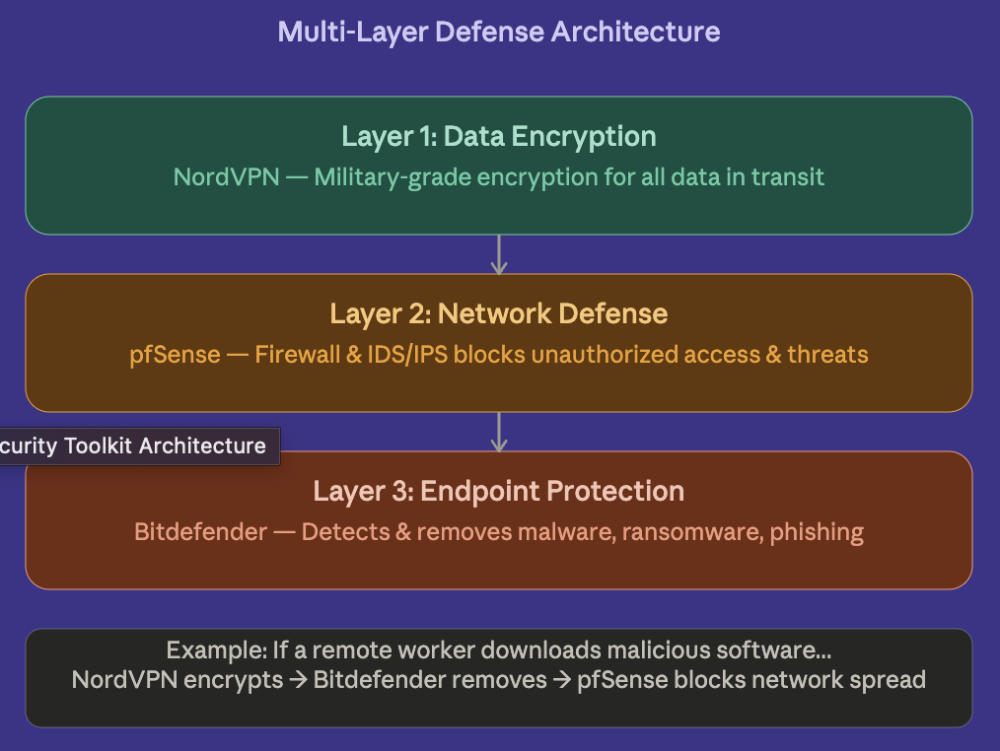
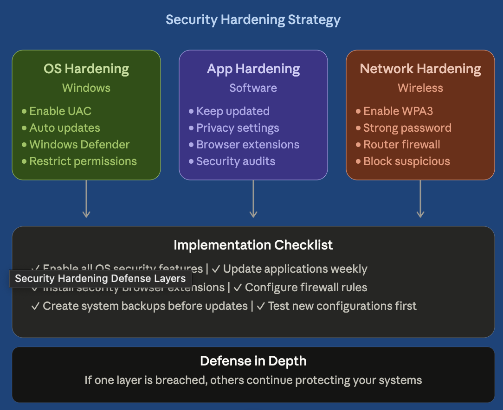
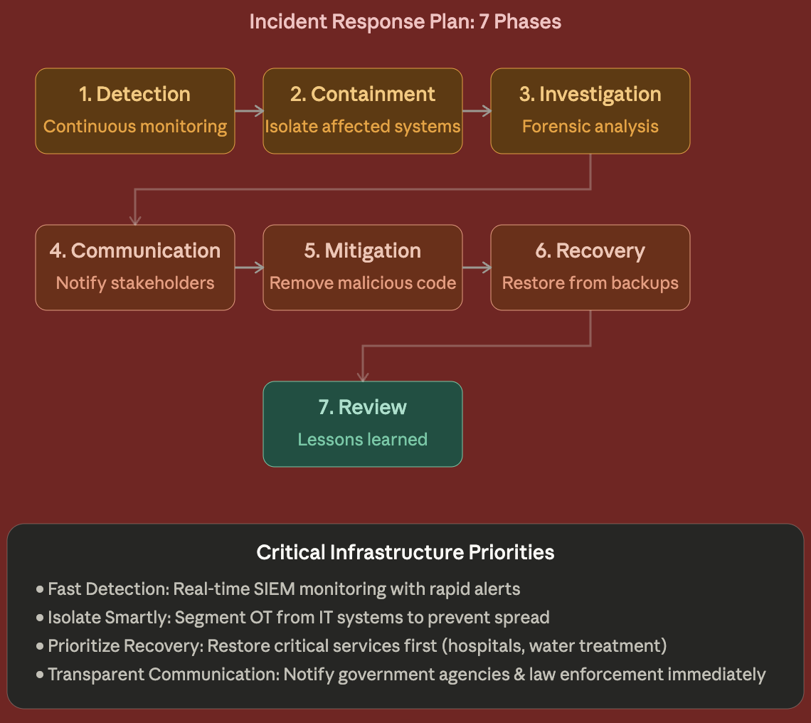

# Defense in Depth and Incident Response

> A layered security toolkit, a system hardening plan, and an incident response strategy for critical infrastructure in the energy sector.

 

## Overview
| | |
|---|---|
| **Objective** | Design layered defenses, harden systems, and plan a response to attacks on critical infrastructure |
| **Tools and standards** | pfSense (firewall + IDS/IPS), endpoint antivirus/EDR, VPN encryption, CISA and NSA hardening guidance |
| **Skills shown** | Security architecture, OS/app/network hardening, IR planning, threat analysis |

---

## Part 1: Security Toolkit Architecture

| Layer | Tool | Purpose |
|---|---|---|
| Endpoint | Bitdefender Total Security | Real-time malware, ransomware, and phishing protection |
| Network | pfSense + IDS/IPS | Traffic filtering, rule enforcement, real-time threat blocking |
| Data in transit | VPN (NordVPN) | Encrypted remote access over untrusted networks |

## Part 2: System Hardening

- **OS:** turn off unneeded services, patch, enforce UAC and Defender, restrict permissions.
- **Application:** keep software updated, use secure configurations, apply least privilege.
- **Network:** firewall rules, segmentation of sensitive data, IDS monitoring.

## Part 3: Energy Sector Defense and Incident Response
**Threats:** ransomware against control systems, and state-sponsored APTs that sit undetected in the network for long periods.
**Cascading impact:** a grid outage spreads to hospitals, communications, water, and financial systems.

**Defense strategy:** segment IT from OT networks, monitor continuously, manage risk proactively.
**IR lifecycle:** Preparation → Detection & Analysis → Containment → Eradication → Recovery → Lessons Learned.

## Key Takeaways
- No single control is enough; layers cover each other's gaps.
- In critical infrastructure, availability comes first, so the IR plan has to prioritize restoring service.
